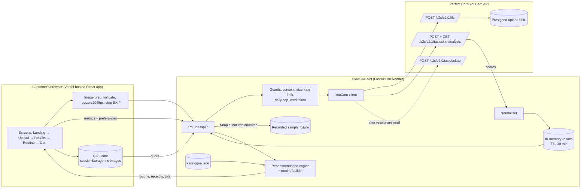

# Architecture

> **Status:** planned design from the GlowCue blueprint (research snapshot 31 Oct 2026). Nothing here is implemented unless [PROJECT_STATUS](PROJECT_STATUS.md) says so. Tags: **[V]** verified, **[A]** assumption, **[R]** recommendation, **[U]** unresolved.

## 7. Technical architecture

### 7.1 Stack decision [R]

| Layer | Choice | Why | Cost |
|---|---|---|---|
| Backend | **Python 3.12+ / FastAPI / Uvicorn / httpx / Pillow / Pydantic v2** | Python is your strength; FastAPI is simple, typed and auto-documents | Free |
| Frontend | **React 19 + Vite 8 + TypeScript 6 (strict) + Tailwind CSS v4** (versions as installed 31 Oct 2026; pinned in `frontend/package.json`) | Fast dev; TS catches agent mistakes; Tailwind lets agents style consistently | Free |
| Routing / state | `react-router-dom` + React Context + `sessionStorage` (no images) | No Redux needed | Free |
| Icons / fonts | Lucide (ISC), Google Fonts **Fraunces** (headings) + **Inter** (body), OFL | Licence-clean | Free |
| Tests | pytest + FastAPI TestClient; Playwright (one e2e smoke) | Standard | Free |
| Hosting | **Backend: Render free web service. Frontend: Vercel Hobby (static).** | See [§14](DEPLOYMENT.md) | Free |
| Data | `catalogue.json` (validated at startup). No DB. | Simplicity | Free |

**Explicitly excluded:** databases, auth, Docker (unless Render's Python version forces it), microservices, extra AI providers, webhooks.

**Python note:** your machine has Python 3.14.6 **[V]**. FastAPI and Pydantic support it **[A]**. On Render, set `PYTHON_VERSION` to match. If any wheel fails to install, fall back to 3.12 locally and on Render.

### 7.2 Responsibilities
1. **Frontend:** UI, client-side image checks and resize, EXIF stripping, polling, preference form, cart state, accessibility.
2. **Backend:** secrets, YouCam calls, server-side validation, caps and limits, normalisation, catalogue, engine, cart quoting.
3. **YouCam client (`youcam_client.py`):** the four calls (file, PUT, task, poll) plus delete and credit. Typed exceptions and retries with backoff on 429 / 5xx (max 2).
4. **Normaliser (`normalize.py`):** raw `output[]` → `NormalizedAnalysis` ([§7.5](DATA_MODEL.md)). Maps `dark_circle_v2` → `dark_circles`, picks `raw_score`, handles missing or unknown types. Masks are not requested or used (no heatmap is implemented).
5. **Catalogue (`catalogue.py`):** loads and validates JSON (unique ids, required fields, allowed enums) and fails fast on startup.
6. **Engine (`engine/`):** pure functions: priorities → candidate filtering → scoring → combination optimiser → explanations.
7. **Routine builder (`engine/routine.py`):** orders steps, assigns AM/PM, applies conflict and frequency rules.
8. **Cart:** client-side state, server-side price quote (prices are never trusted from the client).
9. **Temporary image handling:** the image lives in request memory → YouCam presigned PUT → discarded. Results go in an in-memory TTL dict (30 min, `cachetools.TTLCache`), one worker.
10. **Deployment:** Vercel serves the static frontend, which calls the Render API (`VITE_API_BASE_URL`).

### 7.3 Architecture diagram



**In plain language:** the website in your browser prepares the photo, shrinking it and removing hidden location data, then sends it to our small Python server. Only the server knows the YouCam key. The server hands the photo to YouCam, waits for the scores and highlight images, translates them into GlowCue's own simple format, and (if supported) tells YouCam to delete everything. The browser then sends the scores and your preferences back to the server's "brain", the recommendation engine, which picks products from our catalogue and builds the routine. The cart lives in your browser; the server double-checks prices. A recorded real result is stored on the server so anyone can try the app without spending credits.

### 7.6 Directory structure (planned; not created)

```text
glowcue/
├─ README.md                    # pitch, screenshots, setup, API usage, disclaimer
├─ LICENSE                      # MIT
├─ .gitignore                   # .env, node_modules, __pycache__, dist, *.local
├─ docs/
│  ├─ ARCHITECTURE.md           # diagram + contracts (extracted from here)
│  ├─ YOUCAM_API.md             # verified API facts + Phase-2 findings
│  ├─ PROJECT_STATUS.md         # live status: where work stopped, what is next
│  ├─ decisions/                # ADRs (architecture decision records)
│  ├─ implementation/           # per-phase plans + verification gates
│  ├─ prompts/                  # implementation prompts (one per task)
│  └─ qa/                       # Antigravity reports (Antigravity owns this folder)
├─ backend/
│  ├─ pyproject.toml / requirements.txt
│  ├─ .env.example              # names only, no values
│  ├─ app/
│  │  ├─ main.py                # FastAPI app, CORS, routers
│  │  ├─ config.py              # pydantic-settings: YOUCAM_MODE, keys, caps
│  │  ├─ routes/ (health.py, analyses.py, catalogue.py, recommendations.py, cart.py)
│  │  ├─ services/
│  │  │  ├─ youcam_client.py    # file → PUT → task → poll → delete → credit
│  │  │  ├─ image_validation.py # Pillow checks + metadata strip
│  │  │  ├─ normalize.py
│  │  │  ├─ results_store.py    # TTL cache
│  │  │  └─ limits.py           # per-IP + daily caps, credit floor
│  │  ├─ engine/ (concerns.py, scoring.py, optimiser.py, routine.py, explain.py)
│  │  ├─ models.py              # Pydantic schemas
│  │  ├─ data/catalogue.json
│  │  └─ fixtures/raw/ (gitignored probe output; the planned sample files and masks were not created)
│  ├─ scripts/probe_youcam.py   # one-off Phase-2 probe (manual run only)
│  └─ tests/ (test_normalize.py, test_engine_*.py, test_routes.py, test_catalogue.py)
└─ frontend/
   ├─ package.json, vite.config.ts, tsconfig.json, index.html
   ├─ .env.example              # VITE_API_BASE_URL
   ├─ public/ (favicon.svg, og-image.png, products/*.svg)
   ├─ src/
   │  ├─ main.tsx, App.tsx, routes.tsx
   │  ├─ styles/ (index.css → Tailwind theme tokens)
   │  ├─ lib/ (api.ts, imagePrep.ts, format.ts, types.ts)
   │  ├─ state/ (SessionContext.tsx, CartContext.tsx)
   │  ├─ components/ (Button, Card, Badge, ScoreBar, ProductCard, ReceiptList,
   │  │               RoutineTimeline, BudgetMeter, Disclaimer, ErrorState, Stepper, Drawer)
   │  └─ pages/ (Landing, Analyze, Processing, Results, Preferences, Routine, Cart, Checkout, NotFound)
   └─ e2e/smoke.spec.ts         # Playwright, mock mode (planned; not created)
```

---
